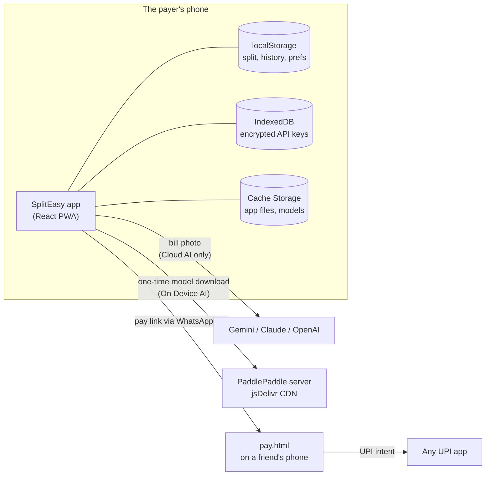
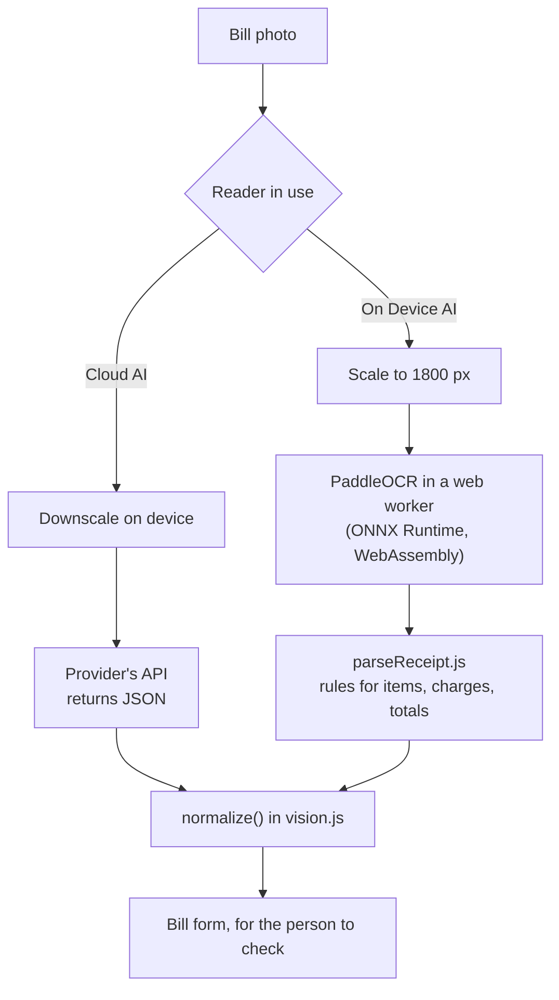

# Contributing to SplitEasy

Thanks for helping out. This page covers how to run the app locally, how it is put together, and how changes get shipped.

- [Getting started](#getting-started)
- [Project layout](#project-layout)
- [Architecture](#architecture)
- [Working on the code](#working-on-the-code)
- [Shipping changes](#shipping-changes)

## Getting started

You need Node.js 22.

```sh
npm install
npm run dev       # dev server at http://localhost:5173 (service worker disabled)
npm test          # unit tests (Vitest); npm run test:watch while you work
npm run lint      # ESLint: undefined names, unused code, hook mistakes
npm run check     # lint + tests + build, the same checks the deploy runs
npm run build     # production build to dist/, with the service worker
npm run preview   # serve dist/ to test the installed-app behaviour
npm run icons     # regenerate the app icons from public/logo.svg
```

Payment links need a public URL to point at. Locally, create `.env.local` (it is git-ignored, so never commit it):

```sh
VITE_PUBLIC_URL=http://localhost:5173/
```

Without it, links are only created when the app is served over HTTPS, and they point at the page's own address.

## Project layout

```
index.html, pay.html        the two pages: the app, and the page friends open from a payment link
src/
  main.jsx                  starts the app
  App.jsx                   app shell: state, routing, header, which screen shows
  screens/                  one file per screen
  components/               shared UI: sheets, dialogs, footers, icons, styles
  hooks/                    shared React hooks (theme, swipeable tabs)
  lib/                      plain logic, no UI (most of it has tests)
  scan/                     reading bill photos (cloud and on device)
  pay/main.js               the pay page's script
  index.css                 colour tokens (light and dark), animations
```

| Path | What it does |
|---|---|
| `src/App.jsx` | Holds the split in progress and history, syncs the URL, shows the header and the current screen |
| `src/screens/HomeHero.jsx` | Home screen intro and the "Why SplitEasy" sheet |
| `src/screens/BillStep.jsx` | Step 1: home buttons, scanning a photo, and the bill form |
| `src/screens/ScanSetup.jsx` | "How to read bills" sheet: On Device AI downloads and Cloud AI keys |
| `src/screens/PeopleStep.jsx` | Step 2: who is splitting, with saved people |
| `src/screens/SplitStep.jsx` | Step 3: who had each item, split by quantity, how charges are shared |
| `src/screens/SettleStep.jsx` | The result: each person's share, sharing, QR, marking paid |
| `src/screens/History.jsx` | Saved splits and saved payment requests |
| `src/screens/Settings.jsx` | UPI details, bill scanning, saved people, theme, erasing data |
| `src/components/Sheet.jsx` | Bottom sheet (a modal on wide screens); Back closes it |
| `src/components/QrSheet.jsx` | "Scan to pay" UPI QR |
| `src/components/TextField.jsx` | The app's text field (sizes, error state); use it for every text input |
| `src/components/Select.jsx` | The app's dropdown (themed list, keyboard support); use it instead of `<select>` |
| `src/components/AddPersonInput.jsx` | Name field with an Add button, used on the People step and in Settings |
| `src/hooks/useAddPerson.jsx` | The rules for adding someone by name, including the "Same person?" question |
| `src/components/styles.js` | Shared inline styles (buttons, cards, the base field style) |
| `src/lib/totals.js` | **Who owes what.** The only place shares are calculated |
| `src/lib/splitLink.js` | Packs a split into a payment link and unpacks it again |
| `src/lib/payment.js` | Share messages, pay page links, UPI links, share or copy |
| `src/lib/requests.js` | Payment links opened on this device (written by the pay page, listed in History) |
| `src/lib/historySearch.js` | History search and the person filter |
| `src/lib/billForm.js` | The bill form's charge rows: charges and discounts as an amount or a percentage of the items, and totals |
| `src/lib/storage.js` | localStorage hooks and keys for the split, history and preferences |
| `src/lib/savedPeople.js` | Saved people with permanent ids: adding, matching a typed name, renaming everywhere, the one-time id upgrade |
| `src/lib/routes.js` | Hash routes for each screen |
| `src/lib/scanSettings.js` | Which reader is in use, saved Cloud AI keys, the last scanned photo |
| `src/lib/secureStore.js` | Encrypts API keys in IndexedDB with a non-extractable key |
| `src/scan/vision.js` | Bill scanning: cloud providers, the on-device route, and cleaning up results |
| `src/scan/models.js` | On Device AI engines: consented download, cache checks, removal |
| `src/scan/basicScan.js` | Runs PaddleOCR in a web worker on a scaled-down photo |
| `src/scan/parseReceipt.js` | Rule-based parser: OCR text to items, charges, round-off and total |
| `src/pay/main.js` | The pay page: unpacks the link, shows the share, pay buttons, full bill, Mark as paid |
| `vite.config.js` | Build (two pages), PWA manifest and service worker caching rules |
| `eslint.config.js` | Lint rules |
| `.github/workflows/deploy.yml` | Lints, tests, builds and deploys to GitHub Pages on every push to `main` |

## Architecture

SplitEasy is a static, offline-first PWA. There is no backend: the app, the pay page and the service worker are plain files on GitHub Pages, and everything a person enters stays in their browser.



### The flow

The app is four steps in one component tree, with hash routes so the browser's Back button works:

| Route | Screen |
|---|---|
| `#/` | Home |
| `#/bill/scan`, `#/bill/manual` | Reading a photo, and the bill form |
| `#/people` | People |
| `#/assign` | Split: who had each item |
| `#/summary` | Settle: each person's share, sharing and payments |
| `#/history`, `#/history/<id>` | Saved splits, and saved payment requests |
| `#/settings` | Settings |

Bottom sheets add their own history entry, so Back closes the sheet rather than leaving the screen.

`src/lib/totals.js` is the one place shares are calculated: each item is divided among the people on it (by quantity when it was split that way), and shared charges plus any round-off are divided equally or in proportion to each person's items. The app's screens, the share messages and the pay page all use it, so they always agree.

### Storage

| Where | Key | Holds |
|---|---|---|
| localStorage | `spliteasy:v1` | The split in progress, saved people (`{ id, name }`), UPI ID, theme |
| localStorage | `spliteasy:history` | Saved splits (one is added when a split reaches Settle) |
| localStorage | `spliteasy:requests` | Payment links opened on this device (written by `pay.html`) |
| localStorage | `spliteasy:taxSplit`, `spliteasy:roundOff` | Last-used choices for new bills |
| localStorage | `spliteasy:engine:<id>` | Marks an On Device AI engine as downloaded |
| IndexedDB | `spliteasy-secure` | API keys, AES-GCM encrypted with a non-extractable key |
| Cache Storage | `spliteasy-models-v1` | On Device AI model files and runtime |
| Cache Storage | `spliteasy-scan-photo` | A reduced copy of the last scanned photo, until the split is reset |

The encryption keeps raw API keys out of plain storage, but any script running on the same origin could still use them. Keep the app free of third-party scripts.

### Saved people

Every saved person has a permanent id, and each person in a split records it as `contactId`. Renaming someone in Settings renames them in every saved split by that id, and the History filter groups splits by it. Removing someone from the saved list keeps the id in old splits, so typing their name again asks whether it's the same person and reconnects them. A different person needs a distinct name, so no split or message shows two people with one name. Data from before ids existed is upgraded on start, treating the same name as the same person (`assignContactIds`).

### Bill scanning



- **Cloud AI:** the person's own key is sent with the photo directly to the provider. Model lists and request formats live in `PROVIDERS` in `vision.js`.
- **On Device AI:** nothing downloads until the person taps Download. Files go into `spliteasy-models-v1`, and the service worker serves the runtime from there, so scanning works offline. Each scan starts a fresh OCR worker and ends it afterwards, because WebAssembly memory never shrinks and reusing one worker can run a phone out of memory.
- **The parser** groups text into rows (with tilt correction), splits glued number columns where quantity × rate = amount, classifies rows by keywords, and picks the printed total that matches items plus charges. The result carries a check of computed against printed total, which the review screen shows.

### Payment links

A link looks like `pay.html#<data>`. The whole split is packed into the part after `#`, so it never reaches a server: browsers don't send it, and link previews only see the static card in `pay.html`.

The data is base64url of text fields separated by control characters (format version `2`). It holds the bill name, currency, payee, UPI ID, whose share it is (or `-` for a group link), names, items with bitmasks of who shared them, charges, who has paid, and the charge-split and round-off choices. `src/lib/splitLink.js` writes it (`packSplit`) and reads it back into the app's own shapes (`unpackSplit`), so the pay page works out shares with the same `totals.js` as the app. Tests pin the exact link strings older versions produced: if they fail, links people already shared would break. To change the format, add a new version and keep reading the old one.

### Installing and updating

`vite-plugin-pwa` precaches the app shell. The large on-device code is cached at runtime instead, only for people who download a reader. New versions install in the background, and `UpdatePrompt.jsx` asks before switching. It checks on launch, when the app returns to the foreground, and hourly.

## Working on the code

- **Styling:** components use inline styles with the colour tokens from `src/index.css` (`var(--surface)`, `var(--accent)` and so on). Use tokens rather than hard-coded colours so dark mode keeps working. Use `TextField` for text inputs rather than a styled `<input>`, so every field looks and behaves the same, and `Select` rather than `<select>`.
- **Phones first:** check every change at 390 × 844, and at 320 × 568 for small screens. Main actions sit at the bottom, within reach of a thumb.
- **Motion:** keep animations short and subtle, and respect `prefers-reduced-motion`.
- **Dependencies:** the app is small on purpose. Talk it through in an issue before adding one.
- **Where code goes:** screens in `src/screens/`, reusable UI in `src/components/`, and anything that isn't UI in `src/lib/` (or `src/scan/` for bill reading), where it can be tested. Keep money math in `totals.js`.
- **Tests:** `npm test` runs the unit tests next to the code (`*.test.js`). Add or update tests when you change totals, payment links, routes, saved requests or the receipt parser. Parser tests use made-up receipts in `src/scan/__fixtures__/`.
- **Check it in the browser too:** run the flow you changed: enter or scan a bill, split it, settle, and open the pay link (personal and group).
- **Privacy:** never commit real bill photos, names or UPI IDs. Use made-up receipts and placeholder IDs such as `name@example`.

## Shipping changes

1. Fork the repo and create a branch.
2. Make your change and run `npm run check` (lint, tests and build).
3. Open a pull request that explains what changed and why. Include before and after screenshots for anything visual.

Every push to `main` is linted, tested, built and deployed to GitHub Pages automatically. A failing check stops the deploy, but keep `main` in a working state anyway. The public URL used in payment links comes from the `VITE_PUBLIC_URL` repository variable (Settings, Secrets and variables, Actions, Variables).
