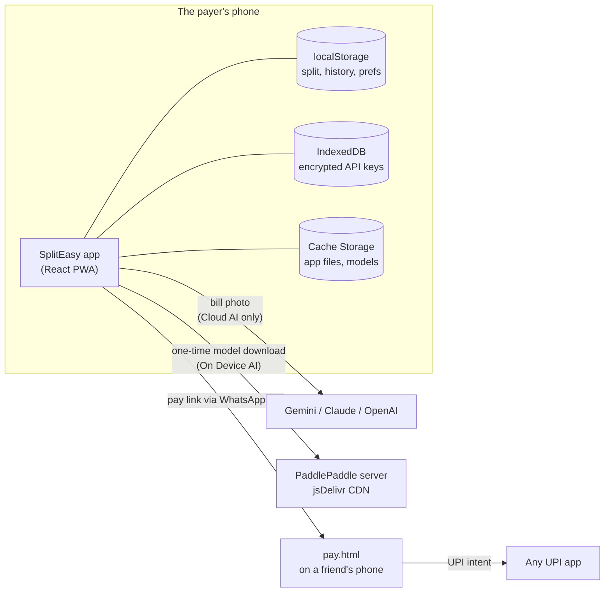
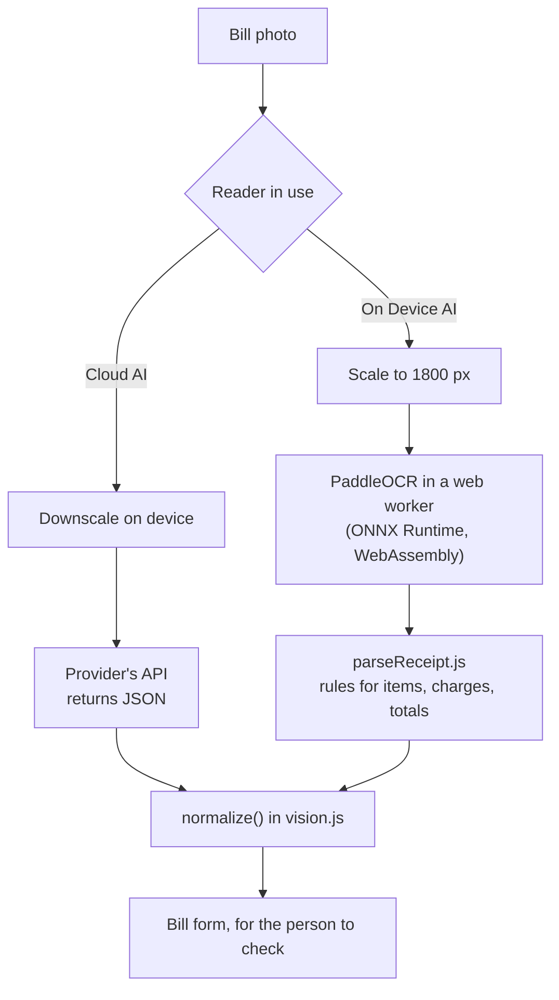

# Contributing to SplitEasy

Thanks for helping out. This page covers how to run the app locally, how it is put together, and how changes get shipped.

- [Getting started](#getting-started)
- [Project layout](#project-layout)
- [Architecture](#architecture)
- [Working on the code](#working-on-the-code)
- [Shipping changes](#shipping-changes)

## Getting started

You need Node.js 22.

```sh
npm install
npm run dev       # dev server at http://localhost:5173 (service worker disabled)
npm run build     # production build to dist/, with the service worker
npm run preview   # serve dist/ to test the installed-app behaviour
npm run icons     # regenerate the app icons from public/logo.svg
```

Payment links need a public URL to point at. Locally, create `.env.local` (it is git-ignored, so never commit it):

```sh
VITE_PUBLIC_URL=http://localhost:5173/
```

Without it, links are only created when the app is served over HTTPS, and they point at the page's own address.

## Project layout

| Path | What it does |
|---|---|
| `src/BillSplitter.jsx` | The app: screens, routing, state, sheets and dialogs |
| `src/payment.js` | Share messages, pay links (packing a split into a URL), UPI links |
| `src/vision.js` | Bill scanning: cloud providers, the on-device route, and cleaning up results |
| `src/local/models.js` | On Device AI engines: consented download, cache checks, removal |
| `src/local/basicScan.js` | Runs PaddleOCR in a web worker on a scaled-down photo |
| `src/local/parseReceipt.js` | Rule-based parser: OCR text to items, charges, round-off and total |
| `src/secureStore.js` | Encrypts API keys in IndexedDB with a non-extractable key |
| `src/GPay.jsx` | Shared bottom sheet, and the "Scan to pay" UPI QR sheet |
| `src/InstallPrompt.jsx` | Install banner and the Install section in Settings |
| `src/UpdatePrompt.jsx` | "Update available" dialog for new versions |
| `src/index.css` | Colour tokens (light and dark), animations, small layout helpers |
| `public/pay.html` | The page friends open from a payment link. Standalone, no build step |
| `vite.config.js` | Build, PWA manifest and service worker caching rules |
| `.github/workflows/deploy.yml` | Builds and deploys to GitHub Pages on every push to `main` |

## Architecture

SplitEasy is a static, offline-first PWA. There is no backend: the app, the pay page and the service worker are plain files on GitHub Pages, and everything a person enters stays in their browser.



### The flow

The app is four steps in one component tree, with hash routes so the browser's Back button works:

| Route | Screen |
|---|---|
| `#/` | Home |
| `#/bill/scan`, `#/bill/manual` | Reading a photo, and the bill form |
| `#/people` | People |
| `#/assign` | Split: who had each item |
| `#/summary` | Settle: each person's share, sharing and payments |
| `#/history`, `#/history/<id>` | Saved splits, and saved payment requests |
| `#/settings` | Settings |

Bottom sheets add their own history entry, so Back closes the sheet rather than leaving the screen.

`computeTotals` in `BillSplitter.jsx` is the one place shares are calculated: each item is divided among the people on it (by weight when shares are uneven), and shared charges plus any round-off are divided equally or in proportion to each person's items.

### Storage

| Where | Key | Holds |
|---|---|---|
| localStorage | `spliteasy:v1` | The split in progress, saved people, UPI ID, theme |
| localStorage | `spliteasy:history` | Saved splits (one is added when a split reaches Settle) |
| localStorage | `spliteasy:requests` | Payment links opened on this device (written by `pay.html`) |
| localStorage | `spliteasy:taxSplit`, `spliteasy:roundOff` | Last-used choices for new bills |
| localStorage | `spliteasy:engine:<id>` | Marks an On Device AI engine as downloaded |
| IndexedDB | `spliteasy-secure` | API keys, AES-GCM encrypted with a non-extractable key |
| Cache Storage | `spliteasy-models-v1` | On Device AI model files and runtime |
| Cache Storage | `spliteasy-scan-photo` | A reduced copy of the last scanned photo, until the split is reset |

The encryption keeps raw API keys out of plain storage, but any script running on the same origin could still use them. Keep the app free of third-party scripts.

### Bill scanning



- **Cloud AI:** the person's own key is sent with the photo directly to the provider. Model lists and request formats live in `PROVIDERS` in `vision.js`.
- **On Device AI:** nothing downloads until the person taps Download. Files go into `spliteasy-models-v1`, and the service worker serves the runtime from there, so scanning works offline. Each scan starts a fresh OCR worker and ends it afterwards, because WebAssembly memory never shrinks and reusing one worker can run a phone out of memory.
- **The parser** groups text into rows (with tilt correction), splits glued number columns where quantity × rate = amount, classifies rows by keywords, and picks the printed total that matches items plus charges. The result carries a check of computed against printed total, which the review screen shows.

### Payment links

A link looks like `pay.html#<data>`. The whole split is packed into the part after `#`, so it never reaches a server: browsers don't send it, and link previews only see the static card in `pay.html`.

The data is base64url of text fields separated by control characters (format version `2`). It holds the bill name, currency, payee, UPI ID, whose share it is (or `-` for a group link), names, items with bitmasks of who shared them, charges, who has paid, and the charge-split and round-off choices. `packSplit` in `payment.js` writes it, `unpack` in `pay.html` reads it, and both must recompute shares the same way as `computeTotals`. If you change the format, bump the version and keep old links working.

### Installing and updating

`vite-plugin-pwa` precaches the app shell. The large on-device code is cached at runtime instead, only for people who download a reader. New versions install in the background, and `UpdatePrompt.jsx` asks before switching. It checks on launch, when the app returns to the foreground, and hourly.

## Working on the code

- **Styling:** components use inline styles with the colour tokens from `src/index.css` (`var(--surface)`, `var(--accent)` and so on). Use tokens rather than hard-coded colours so dark mode keeps working.
- **Phones first:** check every change at 390 × 844, and at 320 × 568 for small screens. Main actions sit at the bottom, within reach of a thumb.
- **Motion:** keep animations short and subtle, and respect `prefers-reduced-motion`.
- **Dependencies:** the app is small on purpose. Talk it through in an issue before adding one.
- **Testing:** there is no automated test suite yet. Run the flow you changed in the browser: enter or scan a bill, split it, settle, and open the pay link. For parser changes, test against several receipts and confirm the computed total still matches the printed one.
- **Privacy:** never commit real bill photos, names or UPI IDs. Use made-up receipts and placeholder IDs such as `name@example`.

## Shipping changes

1. Fork the repo and create a branch.
2. Make your change and run `npm run build` to make sure it builds.
3. Open a pull request that explains what changed and why. Include before and after screenshots for anything visual.

Every push to `main` builds and deploys to GitHub Pages automatically, so `main` must always be in a working state. The public URL used in payment links comes from the `VITE_PUBLIC_URL` repository variable (Settings, Secrets and variables, Actions, Variables).
