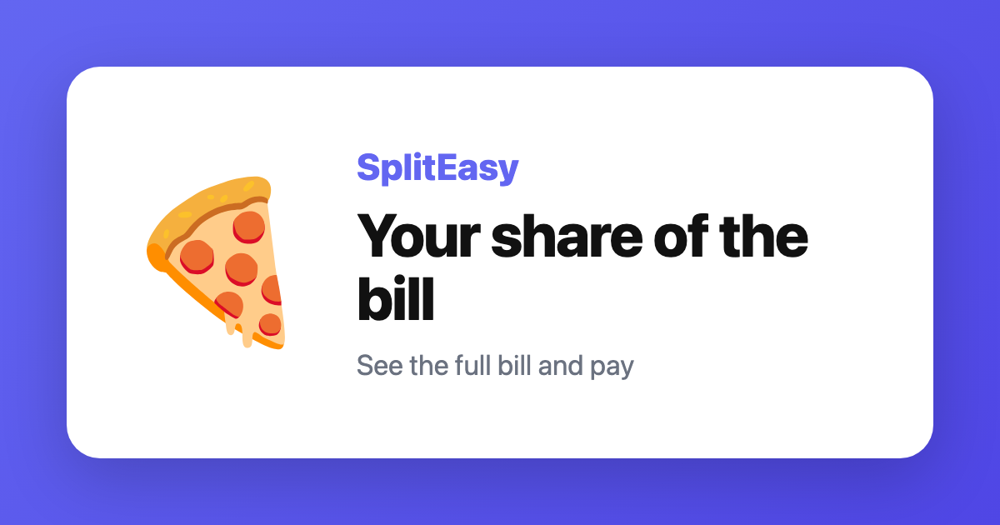
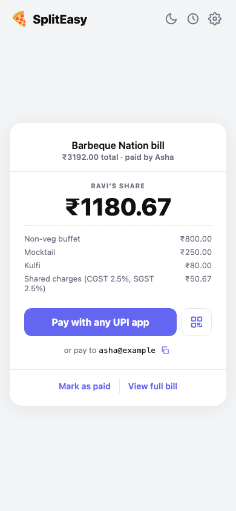
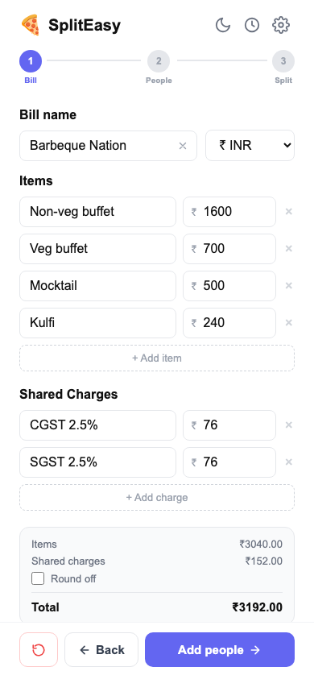
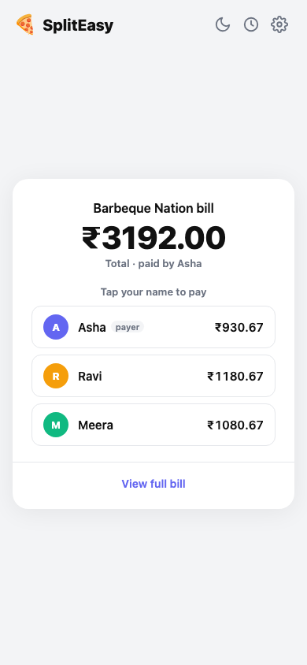
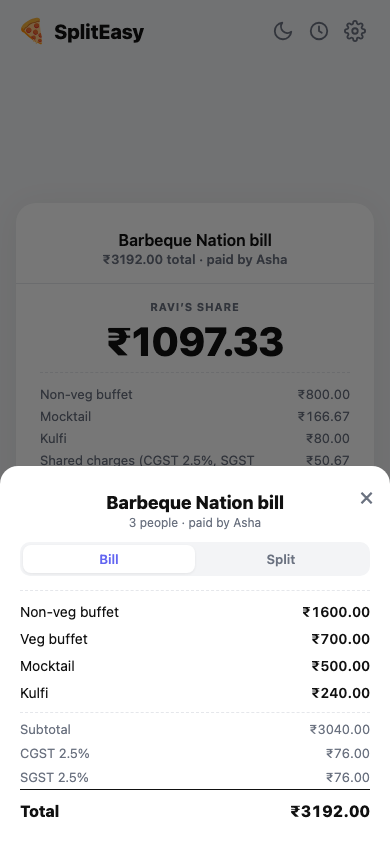
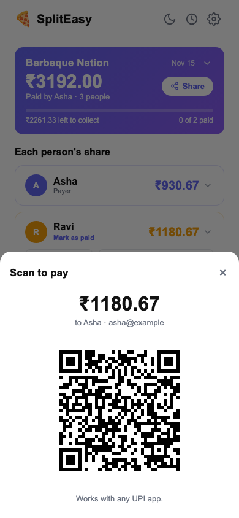
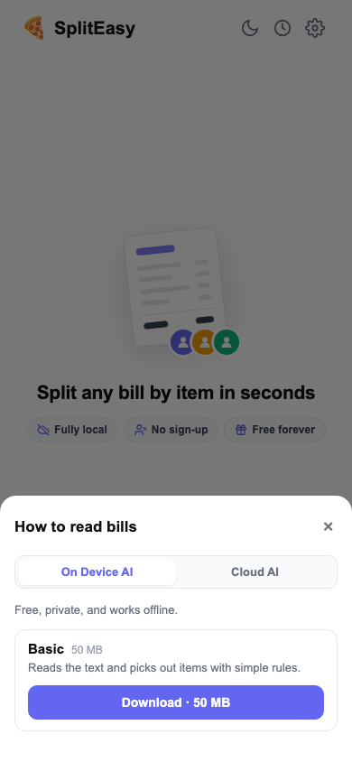

  

<h1 align="center">SplitEasy</h1>

  <strong>Split any bill by item in seconds.</strong> 
  Snap the bill, tap who had what, and send everyone a UPI link for their exact share.

  <a href="https://abhishek-bruno.github.io/bill-splitter/"><strong>Open SplitEasy</strong></a>
  &nbsp;·&nbsp;
  <a href="#how-it-works">How it works</a>
  &nbsp;·&nbsp;
  <a href="#your-data-stays-yours">Privacy</a>
  &nbsp;·&nbsp;
  <a href="CONTRIBUTING.md">Contributing and architecture</a>

  
  
  
  

## Why SplitEasy

Splitting evenly is easy, but rarely fair. One person had the buffet, another had a mocktail, and the GST still has to be shared somehow. SplitEasy splits the bill **by item**, adds each person's part of the taxes and charges, and gives everyone a link to pay their exact amount.

| | |
|---|---|
| **Fully local** | Your splits, history and saved people stay on your phone. No server, no tracking. |
| **No sign-up** | Open it and start splitting. No account, email or phone number. |
| **Free forever** | No ads, no subscription, no limits. |

### Nobody else has to install anything

Most bill-splitting apps only work once everyone has installed them, signed up and joined the same group. In practice, half the table never does, and you end up chasing people anyway.

With SplitEasy, only the person who paid needs it:

- **Settle it right at the table.** Split the bill, then show each person their UPI QR to scan and pay on the spot. No links, no follow-ups.
- **Or share one link in the WhatsApp group you already have.** No invites, no new group, no accounts to create.
- **Friends just tap the link.** It opens in their browser with their share, the full bill and a UPI pay button. No download, no login.
- **It works with everyone,** including the friend who never installs anything and the cousin visiting for one dinner.
- **Nothing to manage afterwards.** No groups to clean up, no notifications, no balances that drag on for months.
| **Works offline** | Install it like an app. Once loaded, it works without a connection. |

## How it works

### 1. Snap the bill

Take a photo or pick one from your gallery, and SplitEasy reads the items, prices, taxes and total for you. Check the result, fix anything it misread, and you're done.

- **On Device AI:** free and private. A one-time download of about 50 MB, after which bills are read on your phone, even offline. Nothing is downloaded until you tap Download.
- **Cloud AI:** for messy or handwritten bills. Bring your own Google Gemini, Anthropic Claude or OpenAI key, and the photo goes straight from your phone to that provider.
- **Or type it in:** quick to enter by hand, with a running total to check against the paper bill.

Long-press a row to reorder it, or drag an item into Shared Charges if the scanner got it wrong. Discounts and round-off are handled too.

 

### 2. Split it item by item

Add the people at the table (your regulars are one tap away) and tap who had each item.

- **Shared dishes are split equally** among the people on them, by default.
- **Split by quantity** when people had different amounts of the same item. Open the item and set how many each person had. For example, 3 mocktails for ₹500: Ravi had 1 and Meera had 2, so Ravi pays ₹166.67 and Meera pays ₹333.33. One tap on "Split equally again" undoes it.
- **Taxes and service charge** are shared equally, or in proportion to what each person ordered.
- **One tap** puts everyone on every item, so you only remove the exceptions.

 

### 3. Settle up

See each person's total with a breakdown, then collect:

- **Share a payment link** on WhatsApp or any app. It shows up as a card with a short message.
- **Show a UPI QR** right at the table.
- **Share the whole split** with the group in one message.
- **Mark people as paid** as the money comes in, and find every split later in History.

 

### 4. Your friends pay in a tap

  
  
  
  

The link opens a simple page in any browser, with no app or account needed.

- **On a group link,** each person taps their name to see their share.
- **Pay with any UPI app** with the amount already filled in, or scan the QR from another phone.
- **View full bill** shows the whole receipt, as printed and split by person, so everyone can check the math.
- **Mark as paid** keeps track, and every request you open is saved under History, Requests.

### 5. Track who has paid

  
  

Every split is saved to **History** automatically when you reach the result, so you never lose track of who owes what.

- **See at a glance** which splits are settled and which are still waiting: "1 of 2 paid", "Settled".
- **Mark each person as paid** as the money comes in. It records the date, and Undo is one tap away.
- **See what's left to collect** on each split, with a progress bar.
- **Remind anyone still owing** by sharing their payment link or showing the QR again, right from History.
- **Edit a saved split** if something changed, or long-press to select and delete old ones.
- **Requests you received** live in their own tab, with your share and whether you've paid.

## Your data stays yours

- **Splits, history, saved people and your UPI ID** are stored only in your browser, on your device.
- **Payment links carry the split inside the link itself,** after the `#`, which browsers never send to a server. Link previews in chat apps only see a generic card.
- **On Device AI** reads bills entirely on your phone. The one-time model download comes from PaddlePaddle's model server and the jsDelivr CDN.
- **Cloud AI** sends only the bill photo, and only to the provider you pick. Your API key is encrypted and kept on your device.
- **No analytics, no ads, no accounts.**

  
  

## Install it on your phone

Open **[SplitEasy](https://abhishek-bruno.github.io/bill-splitter/)** once while online, then:

- **Android (Chrome):** menu, then **Install app**.
- **iPhone (Safari):** Share, then **Add to Home Screen**.

It opens like an app and works offline. When a new version is ready, it asks before updating.

## Contributing

Bug reports, ideas and pull requests are welcome. See **[CONTRIBUTING.md](CONTRIBUTING.md)** for how to run it locally and how the app is put together.

## Credits

Pizza icon from [Noto Emoji](https://github.com/googlefonts/noto-emoji) by Google, licensed under the Apache License 2.0. Bill reading on device uses [PaddleOCR](https://github.com/PaddlePaddle/PaddleOCR) and [ONNX Runtime Web](https://onnxruntime.ai/).
