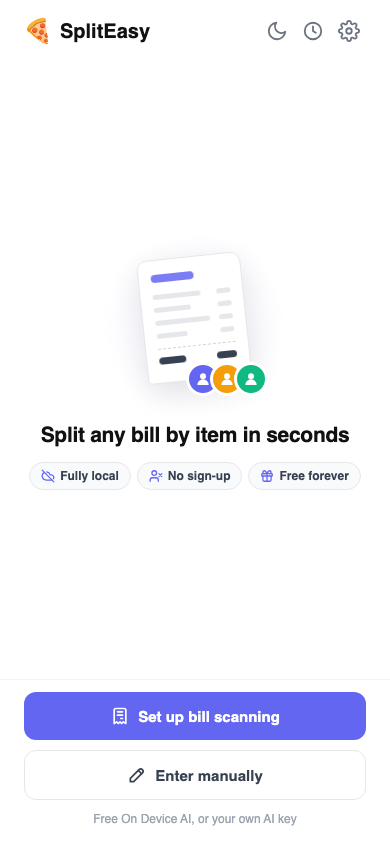
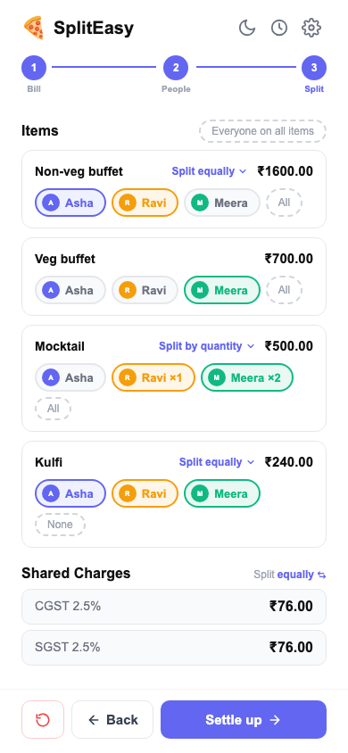
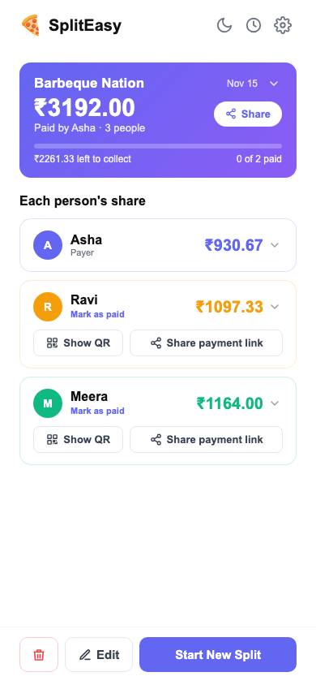
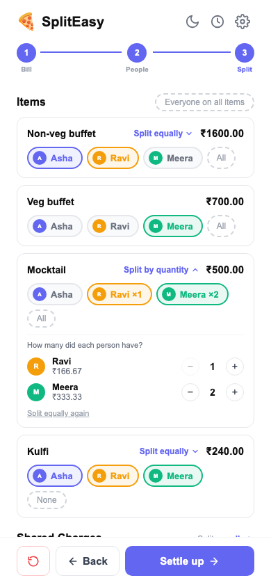
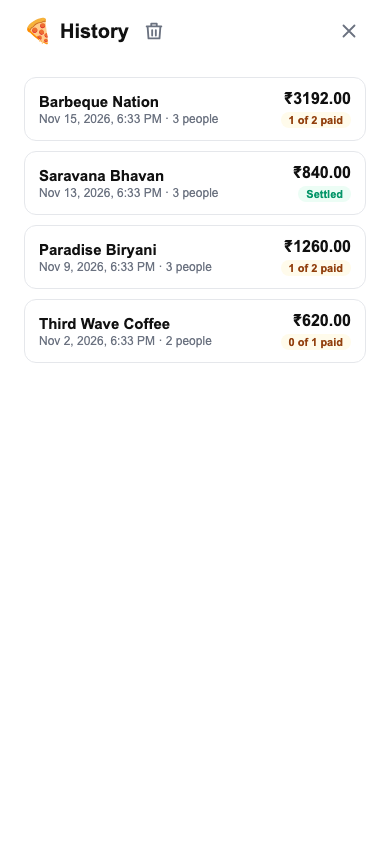
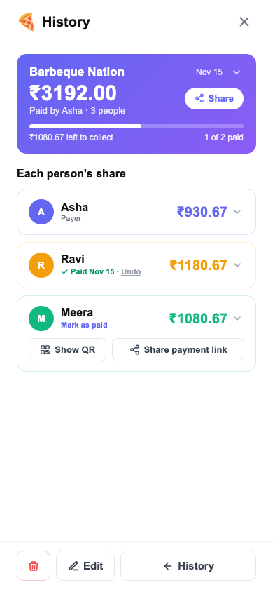
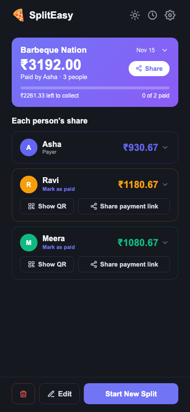

  

<h1 align="center">SplitEasy</h1>

  <strong>Split any bill by item in seconds.</strong> 
  Snap the bill, tap who had what, and send everyone a UPI link for their exact share.

  <a href="https://abhishek-bruno.github.io/bill-splitter/"><strong>Open SplitEasy</strong></a>
  &nbsp;·&nbsp;
  <a href="#how-it-works">How it works</a>
  &nbsp;·&nbsp;
  <a href="#your-data-stays-yours">Privacy</a>
  &nbsp;·&nbsp;
  <a href="CONTRIBUTING.md">Contributing and architecture</a>

  
  
  
  

## Why SplitEasy

Splitting evenly is easy, but rarely fair. SplitEasy splits **by item**, shares the taxes fairly, and tells everyone exactly what they owe.

| 🔒 Fully local | 🙅 No sign-up | 🎁 Free forever | 📴 Works offline |
|:---:|:---:|:---:|:---:|
| Your data stays on your phone | No account, email or number | No ads, no limits | Install it like an app |

## Nobody else has to install anything

Other splitting apps need everyone on the same app. SplitEasy only needs the person who paid.

| | 😩 Typical splitting apps | 😌 SplitEasy |
|---|---|---|
| **Who needs the app** | Everyone at the table | Only the payer |
| **Before you split** | Everyone signs up and joins a group | Nothing, just open it |
| **How friends see it** | In the app, once they've joined | A link in your WhatsApp group, opened in any browser |
| **How they pay** | Settle balances later | 📷 Scan a QR at the table, or tap the link and pay by UPI |
| **Afterwards** | Groups, notifications, balances for months | Nothing to clean up |

## How it works

| 1. 📸 Snap | 2. 👆 Split | 3. 💸 Settle | 4. ✅ Track |
|:---:|:---:|:---:|:---:|
| Scan the bill or type it in | Tap who had each item | Share a link or show a QR | See who has paid |

### 📸 1. Snap the bill

Take a photo, and SplitEasy reads the items, prices, taxes and total. Check it, fix anything, done.

| Read it with | What you get |
|---|---|
| 📱 **On Device AI** | Free and private, works offline after a 50 MB download |
| ☁️ **Cloud AI** | Your own API key (Google Gemini has a free tier), best for messy or handwritten bills |
| ⌨️ **Type it in** | Quick for short bills, with a running total |

- ↕️ **Long-press** a row to reorder it, or move it into Shared Charges.
- 🧾 **Discounts and round-off** are handled.

 

### 👆 2. Split it item by item

Add the people at the table, then tap who had each item.

| Option | How it splits |
|---|---|
| 🍽️ **Shared dishes** | Split equally among the people on them |
| 🔢 **Split by quantity** | Set how many each person had |
| 🧾 **Taxes and charges** | Shared equally, or by what each person ordered |
| ⚡ **Everyone on all items** | One tap, then remove the exceptions |

> **Example:** 3 mocktails for ₹500. Ravi had 1, Meera had 2, so Ravi pays **₹166.67** and Meera pays **₹333.33**.

 

### 💸 3. Settle up

See everyone's total, then collect your way:

| Tap | To |
|---|---|
| 📷 **Show QR** | Let them scan and pay at the table |
| 🔗 **Share payment link** | Send one person their share, on WhatsApp or any app |
| 👥 **Share** | Send the whole split to the group |
| ✅ **Mark as paid** | Tick people off as the money comes in |

 

### 🙌 Your friends pay in a tap

  
  
  
  

| 👆 Tap your name | 💳 Pay by UPI | 🧾 View full bill | ✅ Mark as paid |
|:---:|:---:|:---:|:---:|
| On a group link | Amount filled in, any UPI app | As printed, and split by person | Saved under History |

No app, no login. The link opens in any browser.

### ✅ 4. Track who has paid

  
  

Every split is saved to **History** when you reach the result.

| Feature | What you see |
|---|---|
| 📋 **At a glance** | "1 of 2 paid" or "Settled" on every split |
| ✅ **Mark as paid** | Records the date, with Undo |
| 📊 **Left to collect** | Amount and progress bar |
| 🔁 **Remind** | Share the link or show the QR again |
| ✏️ **Edit or delete** | Fix a split, or long-press to clear old ones |
| 📥 **Requests** | Links you received, with your share and status |

## Your data stays yours

| What | Where it goes |
|---|---|
| Splits, history, people, UPI ID | 📱 Only your phone |
| Payment links | 🔗 Inside the link itself, never sent to a server |
| Bill photo, On Device AI | 📱 Read on your phone |
| Bill photo, Cloud AI | ☁️ Only the provider you pick |
| Your API key | 🔐 Encrypted, on your phone |
| Analytics, ads, accounts | 🚫 None |

  
  

## Install it on your phone

Open **[SplitEasy](https://abhishek-bruno.github.io/bill-splitter/)** once while online, then:

| 🤖 Android (Chrome) | 🍎 iPhone (Safari) |
|:---:|:---:|
| Menu, then **Install app** | Share, then **Add to Home Screen** |

It opens like an app, works offline, and asks before updating.

## Contributing

Bug reports, ideas and pull requests are welcome. See **[CONTRIBUTING.md](CONTRIBUTING.md)** for setup and architecture.

## Credits

Pizza icon from [Noto Emoji](https://github.com/googlefonts/noto-emoji) by Google (Apache License 2.0). On-device bill reading uses [PaddleOCR](https://github.com/PaddlePaddle/PaddleOCR) and [ONNX Runtime Web](https://onnxruntime.ai/).
